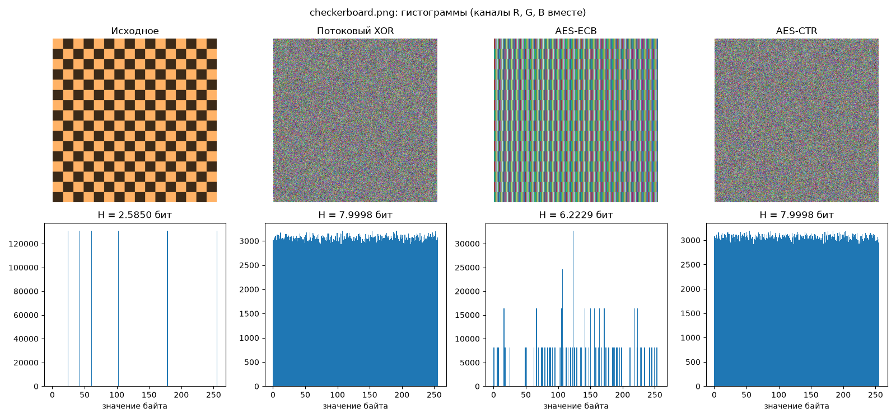
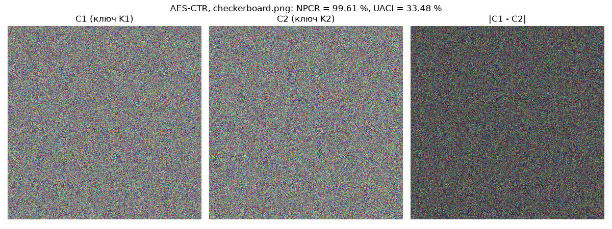

# Отчёт по лабораторной работе №1

## 1. Постановка задачи

Реализованные методы:

1. потоковый XOR с ключевым потоком собственного генератора xorshift32;
2. AES-128-ECB;
3. AES-128-CTR (выбран как второй режим).

Изображения: три выданных (gradient.png, checkerboard.png, noise_texture.png) и мое my_pic.png.

Что сравнивалось: для каждого изображения сравнивались исходный вариант и три шифротекста. Метрики: энтропия, χ² равномерности гистограммы, корреляция соседних пикселей по горизонтали и вертикали, доля повторяющихся 16-байтовых блоков. Основное сравнение проводилось на двух изображениях разного типа: checkerboard.png и my_pic.png. Для checkerboard.png построены гистограммы и проведён эксперимент с изменением ключа (NPCR/UACI).

## 2. Реализация

Шифруется не PNG-файл, а байты пикселей: RGB построчно, H·W·3 байт. Шифротекст сохраняется обратно в PNG того же размера, поэтому его можно смотреть как картинку и считать по нему те же метрики. Ключ у всех методов один: 128 бит (32 hex-символа).

Потоковый XOR (src/ciphers.py):

1. Начальное состояние генератора - первые 4 байта SHA-256(ключ). Если получился 0, берётся 1, потому что из нуля xorshift не выходит.
2. Шаг xorshift32: x ^= x<<13; x ^= x>>17; x ^= x<<5 (по модулю 2³²). Каждое число даёт 4 байта ключевого потока.
3. cipher[i] = plain[i] XOR keystream[i]. Расшифрование - та же функция с тем же ключом.

AES (библиотека pycryptodome):

- ECB: данные дополняются по PKCS#7 и шифруются поблочно, каждый блок независимо. Длина данных кратна 16, поэтому PKCS#7 добавляет целый лишний блок. В PNG сохраняются первые H·W·3 байт шифротекста, а последний блок (tail) записывается в meta.json, иначе расшифровать нельзя.
- CTR: при каждом шифровании генерируется новый случайный nonce (8 байт, os.urandom). Остальные 8 байт блока - счётчик, он начинается с 0. Дополнение не нужно, длина шифротекста равна длине данных.

Хранение nonce. В results/meta.json для каждого файла шифротекста записаны алгоритм, исходный файл, размер и nonce (CTR) или tail (ECB). Ключ не сохраняется. Пример:

    "checkerboard_aes-ctr.png": {
      "algorithm": "aes-ctr",
      "source": "checkerboard.png",
      "shape": [512, 512, 3],
      "nonce": "…16 hex…"
    }

Nonce не секретный, но при одном ключе не должен повторяться. На results/nonce_reuse.png показано, что будет при повторе: gradient и checkerboard зашифрованы одним ключом и одним nonce, и тогда C1 XOR C2 = P1 XOR P2. Ключевой поток сокращается, и наложение двух исходных картинок видно без ключа. У нашего XOR-шифра nonce нет вообще, поэтому два изображения на одном ключе дают такую же утечку.

Проверка обратимости. Для каждой пары «изображение × метод» выполняется исходное -> шифрование -> расшифрование -> \*_restored.png. Сравниваются SHA-256 от байтов пикселей и SHA-256 самих файлов.

## 3. Методика эксперимента

- Основное сравнение: checkerboard.png (512×512) и my_pic.png (256×256). gradient.png и noise_texture.png посчитаны тем же кодом, результаты в results/metrics.csv.
- Энтропия: H = −Σ p(i)·log2 p(i) по всем байтам изображения (каналы R, G, B вместе, 256 значений, максимум 8 бит).
- χ² отклонения гистограммы от равномерной: 255 степеней свободы, критическое значение при α = 0.05 равно 293.2.
- Корреляция Пирсона соседних пикселей: 10 000 случайных пикселей и их сосед справа (горизонталь), ещё 10 000 и сосед снизу (вертикаль). Значения каналов R, G, B объединяются в одну выборку, получается 30 000 пар значений на направление. Позиции пар одинаковые для всех методов (фиксированный seed).
- Повторяющиеся блоки, % - доля 16-байтовых блоков, которые уже встречались раньше. Именно такие блоки ECB шифрует одинаково.
- Чувствительность к ключу: AES-CTR, checkerboard.png. K1 = f2ee2f94d8785c7b720e9272f1c96ca0. K2 получен инверсией младшего бита первого байта: f3ee... Изображение зашифровано обоими ключами с одним и тем же nonce, чтобы разница была только из-за ключа. NPCR и UACI посчитаны по всем 786 432 байтам. Для двух независимых случайных изображений теоретические значения: NPCR = 255/256 = 99.6094 %, UACI = 257/768 = 33.4635 %.

## 4. Результаты

### 4.1. Проверка обратимости

Для всех 12 комбинаций (4 изображения × 3 метода) SHA-256 пикселей и SHA-256 файлов исходного и восстановленного изображений совпали (results/reversibility.csv). Для основных изображений:

| Изображение | Метод | SHA-256 исходного (пиксели) | SHA-256 восстановленного | Пиксели | Файл |
|---|---|-----------------------------|--------------------------|:-------:|:----:|
| checkerboard | XOR | 030160210071f906...         | 030160210071f906...      |   ok    |  ok  |
| checkerboard | AES-ECB | 030160210071f906...         | 030160210071f906...      |   ok    |  ok  |
| checkerboard | AES-CTR | 030160210071f906...         | 030160210071f906...      |   ok    |  ok  |
| my_pic | XOR | ebfdf02d87bc99f6...         | ebfdf02d87bc99f6...      |   ok    |  ok  |
| my_pic | AES-ECB | ebfdf02d87bc99f6...         | ebfdf02d87bc99f6...      |   ok    |  ok  |
| my_pic | AES-CTR | ebfdf02d87bc99f6...         | ebfdf02d87bc99f6...      |   ok    |  ok  |

Дополнительно проверено: если расшифровать CTR ключом с одним изменённым битом, ошибки нет, но получается шум, и SHA-256 не совпадает.

### 4.2. Сводная таблица метрик

checkerboard.png:

| Метод | Энтропия | χ² | Corr H | Corr V | Повт. блоки | Особенности                             |
|---|---:|---:|---:|---:|---:|-----------------------------------------|
| Исходное | 2.5850 | 32 768 000 | 0.9532 | 0.9576 | 99.99 % | 2 цвета - 6 разных байтов, клетки 32×32 |
| Потоковый XOR | 7.9998 | 270.7 | −0.0096 | 0.0022 | 0 % | шум                              |
| AES-ECB | 6.2229 | 2 184 533 | 0.0671 | 0.9727 | 99.99 % | шахматная структура видна полосами      |
| AES-CTR | 7.9998 | 221.0 | 0.0127 | 0.0040 | 0 % | шум                              |

my_pic.png:

| Метод | Энтропия | χ² | Corr H | Corr V | Повт. блоки | Особенности |
|---|---:|---:|---:|---:|---:|---|
| Исходное | 7.4042 | 188 491 | 0.9909 | 0.9928 | 0.50 % | плавный фон, соседние пиксели сильно связаны |
| Потоковый XOR | 7.9992 | 229.3 | −0.0048 | 0.0007 | 0 % | на вид шум |
| AES-ECB | 7.9992 | 215.4 | −0.0062 | 0.0057 | 0.50 % | на вид шум, но повторы блоков сохранились |
| AES-CTR | 7.9991 | 235.6 | −0.0027 | 0.0149 | 0 % | на вид шум |

Для справки, остальные изображения (полностью в results/metrics.csv):

| Изображение | Метод | Энтропия | Corr H | Corr V | Повт. блоки |
|---|---|---:|---:|---:|---:|
| gradient | исходное | 7.9716 | 1.0000 | 1.0000 | 0 % |
| gradient | XOR / ECB / CTR | 7.9998 / 7.9998 / 7.9998 | \|r\| < 0.01 | \|r\| < 0.01 | 0 % |
| noise_texture | исходное | 4.8060 | 0.9554 | 0.9561 | 0 % |
| noise_texture | XOR / ECB / CTR | 7.9998 / 7.9997 / 7.9998 | \|r\| < 0.02 | \|r\| < 0.02 | 0 % |

### 4.3. Гистограммы

Такой же набор для своего изображения: results/histograms_my_pic.png.

### 4.4. Чувствительность к изменению ключа (AES-CTR, checkerboard.png)

| Метод | Изменение ключа | NPCR | UACI | NPCR (идеал) | UACI (идеал) |
|---|---|---:|---:|---:|---:|
| AES-CTR | 1 бит (младший бит байта 0) | 99.6110 % | 33.4593 % | 99.6094 % | 33.4635 % |

## 5. Анализ

Корреляция. У всех исходных изображений соседние пиксели сильно связаны: от 0.95 (checkerboard, связь рвётся только на границах клеток) до 1.00 (gradient). XOR и AES-CTR снижают корреляцию почти до нуля, |r| ≤ 0.02 в обоих направлениях. Это уровень случайного разброса для выборки такого размера.

AES-ECB на checkerboard даёт Corr H = 0.07, но Corr V = 0.97, почти как у исходного. Причина: внутри клетки все строки одинаковые, ECB превращает одинаковые блоки в одинаковые шифроблоки, поэтому пиксель и его сосед снизу совпадают. Горизонтальная корреляция при этом низкая, потому что внутри 16-байтового шифроблока байты уже перемешаны.

Энтропия и гистограмма. Максимум для равномерного распределения - 8 бит. Для конечной выборки ожидаемое значение примерно 8 − 255/(2N·ln2): 7.9998 при N = 786 432 и 7.9991 при N = 196 608. XOR и CTR попадают в эти значения на всех изображениях, а χ² меньше критических 293.2, то есть гистограмма неотличима от равномерной.

У исходного checkerboard всего 6 разных значений байтов в равных долях, поэтому H = log2 6 = 2.585. У ECB H = 6.22, χ² = 2.2·10⁶, на гистограмме отдельные пики вместо ровного «плато». Дело в том, что во всём изображении всего 6 разных 16-байтовых блоков (2 цвета × 3 варианта сдвига RGB-тройки внутри блока). Значит, в шифротексте тоже только 6 разных блоков, то есть не больше 96 разных байтов.

Почему ECB отличается от CTR. ECB - это просто замена «блок -> блок»: E_K(P) зависит только от содержимого блока, а не от его места в изображении. Повторы блоков в открытом тексте переходят в шифротекст один к одному: у checkerboard 99.99 % и там, и там. CTR шифрует P_i XOR E_K(nonce ‖ i), номер блока входит в гамму, поэтому одинаковые блоки на разных местах дают разный шифротекст, и повторов 0 %.

При этом утечка ECB зависит от картинки. На gradient цвет меняется по обеим осям, поэтому одинаковых 16-байтовых блоков нет. На noise_texture и на фото мешает шум (на фото - от JPEG). На этих изображениях ECB по всем метрикам неотличим от CTR. На фото повторяются только 61 блок из 12 288 (0.5 %, засвеченные белые участки). ECB эти повторы сохраняет, а CTR нет, но на энтропию и корреляцию это не влияет. Метрика «повторы блоков» здесь показательнее энтропии.

Потоковый XOR (xorshift32). По всем статистическим метрикам наш XOR неотличим от AES-CTR, но криптографически он слабый:

- реальное пространство ключей - 2³² состояний (128-битный ключ сжимается до 32-битного seed), это перебирается за минуты;
- выход xorshift32 и есть его состояние, поэтому 4 известных байта открытого текста (например, известный цвет фона) дают состояние, а из него и весь остальной поток;
- nonce нет, поэтому один ключ на двух картинках даёт C1 XOR C2 = P1 XOR P2, как на nonce_reuse.png.

Вывод: хорошие энтропия, гистограмма и корреляция - необходимое, но не достаточное условие стойкости.

Чувствительность к ключу. Изменение одного бита ключа AES дало NPCR = 99.61 % и UACI = 33.46 %. Это совпадает с теоретическими значениями для независимых случайных изображений (99.61 % и 33.46 %): шифротексты на K1 и K2 статистически никак не связаны, на картинке |C1 − C2| нет никакой структуры. Это лавинный эффект AES.

Графики и числа согласуются. ECB-шифротекст checkerboard на вид - явные полосы, и в цифрах ему соответствуют пиковая гистограмма, H = 6.22, огромный χ² и Corr V = 0.97. Шифротексты, которые выглядят как шум (XOR, CTR, а также ECB на градиенте и на фото), имеют почти идеальные значения всех метрик. Расхождений между тем, что видно, и числами нет. Одна оговорка: если ECB-шифротекст выглядит как шум, это ещё не значит, что утечки нет. Повторы блоков на фото глазом не видны, но метрика их находит.

## 6. Итоговый вывод

1. Все три метода обратимы: SHA-256 исходных и восстановленных изображений совпали во всех 12 случаях.
2. AES-CTR и потоковый XOR полностью разрушают статистическую структуру: энтропия ≈ 8 бит (с учётом размера выборки), гистограмма равномерная (χ² < 293), корреляция соседних пикселей ≈ 0 в обоих направлениях.
3. AES-ECB сохраняет закономерности, если в изображении есть одинаковые 16-байтовые блоки. На шахматной доске это видно и глазом, и в цифрах: H = 6.22 вместо 8, Corr V = 0.97, повторов блоков 99.99 %. На градиенте, шумовой текстуре и фото повторов почти нет, и там ECB по метрикам неотличим от CTR. Поэтому ECB для изображений не подходит, хотя утечка проявляется не на каждой картинке.
4. Один изменённый бит ключа AES даёт NPCR 99.61 % и UACI 33.46 %, это практически идеальные значения.
5. Свой XOR на xorshift32 статистически выглядит так же хорошо, как AES-CTR, но у него 32-битное пространство ключей, поток восстанавливается по 4 известным байтам, и нет nonce. Статистические тесты сами по себе не доказывают стойкость шифра.
